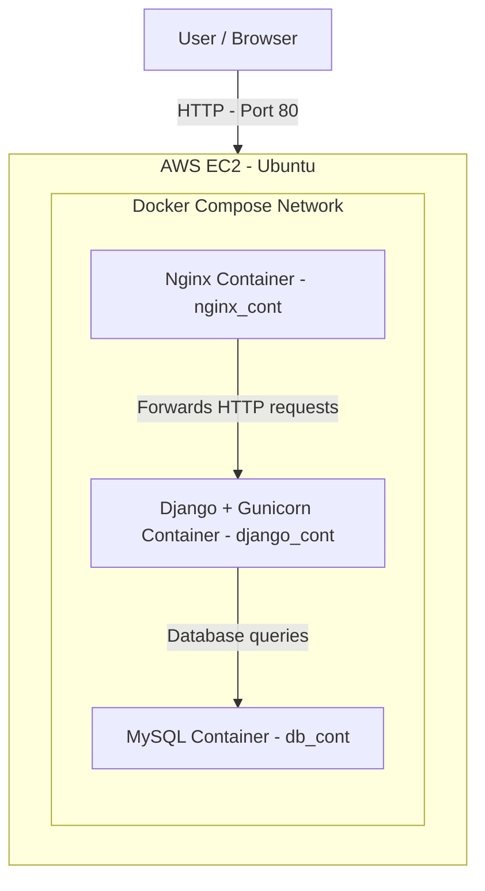

# Django Notes App — AWS Deployment

## Project Overview

This project documents the deployment of a Django-based Notes Application on AWS EC2 using Docker and Docker Compose.

The focus of this project is cloud infrastructure, containerization, and application deployment.

## Technologies Used

- AWS EC2
- Ubuntu Linux
- Docker
- Docker Compose
- Nginx
- Gunicorn
- Django
- MySQL

## Deployment Architecture

The application uses a multi-container architecture:

- **Nginx:** Receives incoming HTTP requests and forwards them to the application.
- **Gunicorn:** Runs the Django application.
- **Django:** Handles application logic and requests.
- **MySQL:** Stores application data.

## My Contributions

My work focused on deploying and configuring the existing application:

- Deployed the application on an AWS EC2 instance.
- Configured Docker and Docker Compose for containerized services.
- Configured Nginx to handle incoming HTTP traffic.
- Used Gunicorn as the Django application server.
- Configured the MySQL service.
- Worked with Linux and AWS EC2 during deployment and troubleshooting.

## Screenshots

Screenshots of the deployed application and deployment setup will be added here.

## Original Application

The application source was created by [LondheShubham153](https://github.com/LondheShubham153/django-notes-app).

This repository documents my cloud deployment work and does not claim original authorship of the application.

## Disclaimer

This is a deployment and learning portfolio project. The original application source belongs to its respective author.

## Architecture Diagram

